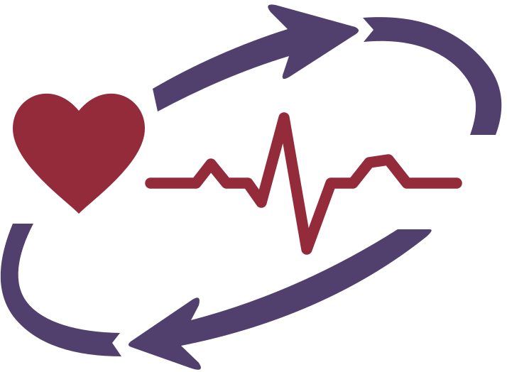
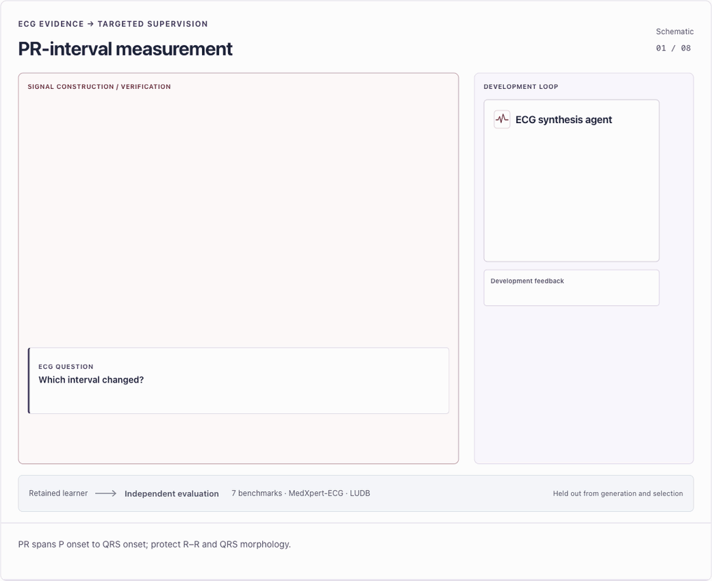

<div align="center">

<p> &nbsp;&nbsp;  &nbsp;&nbsp;  &nbsp;&nbsp; </p>

<h1> ECG-RSI: Recursive Self-Improvement through<br>Targeted Electrocardiogram Waveform Evolution</h1>

<p>Xiaoliang&nbsp;Wang<sup>1,2*</sup>, Zhuo&nbsp;Chen<sup>2*</sup>, Chuanyang&nbsp;Zheng<sup>2</sup>, Jiangwei&nbsp;Lao<sup>2</sup>, Quanbin&nbsp;Wang<sup>2</sup>,<br>
Honglin&nbsp;Lin<sup>3,4</sup>, Jiajia&nbsp;Liu<sup>2</sup>, Zhihong&nbsp;Lu<sup>2</sup>, Hao&nbsp;Jin<sup>1</sup>, Jian&nbsp;Wang<sup>2</sup>, Lijun&nbsp;Wu<sup>2,3†</sup></p>

<p><sub><sup>1</sup>&nbsp;Zhejiang&nbsp;University &nbsp;·&nbsp; <sup>2</sup>&nbsp;Ant&nbsp;Group &nbsp;·&nbsp; <sup>3</sup>&nbsp;Shanghai&nbsp;Artificial&nbsp;Intelligence&nbsp;Laboratory &nbsp;·&nbsp; <sup>4</sup>&nbsp;Shanghai&nbsp;Jiao&nbsp;Tong&nbsp;University<br>
<sup>*</sup> Equal contribution &nbsp;·&nbsp; <sup>†</sup> Corresponding author</sub></p>

[](papers/ecg-rsi.pdf)
[](https://pork-pay.github.io/ECG-RSI/)
[](https://github.com/pork-pay/ECG-RSI/stargazers)
[](#results)
[](#release-plan)

</div>

<p align="center">
  <a href="https://pork-pay.github.io/ECG-RSI/#evolution"></a>
</p>

<p align="center">
  <strong>The best teaching strategy changes as the learner improves.</strong><br>
  Check learning gains on independent benchmarks.<br>
  <a href="https://pork-pay.github.io/ECG-RSI/#evolution">Explore the interactive walkthrough →</a>
</p>

## Results

**Qwen3.5-35B-A3B · main results on seven external benchmarks · three rounds.**
Accuracy and multi-label F1 are reported on a 0–100 scale.

| Benchmark | Metric | Base (R0) | ECG-RSI (R3) |
|:--|:--|--:|--:|
| MMMU-ECG (ECGBench) | Accuracy | 42.00 | **57.50** |
| CSN | Accuracy | 30.91 | **67.23** |
| G12EC | Accuracy | 41.36 | **66.24** |
| ECG-QA (PTB-XL) | Exact-match accuracy | 23.99 | **33.18** |
| PTB-XL | F1 | 29.50 | **38.30** |
| CPSC2018 | F1 | 13.10 | **22.80** |
| CODE-15% | F1 | 30.20 | **41.00** |
| **QA mean (4 benchmarks)** | Accuracy | **34.57** | **56.04** |
| **Classification mean (3 datasets)** | F1 | **24.27** | **34.03** |

The two means give equal weight to each benchmark within the corresponding task group. CSN denotes Chapman–Shaoxing–Ningbo; G12EC denotes the Georgia 12-Lead ECG Challenge Database.

[Full results and comparisons →](https://pork-pay.github.io/ECG-RSI/#findings)

## Release plan

| Item | Status |
|:--|:--|
| Paper (PDF) | ✅ [Available](papers/ecg-rsi.pdf) |
| Project page & interactive demo | ✅ [Available](https://pork-pay.github.io/ECG-RSI/) |
| arXiv posting | 🔜 In progress |
| Discovered programs | ⏳ Being prepared |
| Full codebase | ⏳ Being prepared |
| Reproduction scripts | ⏳ Being prepared |

Related project: [MedEvo](https://pork-pay.github.io/MedEvo/)

<details>
<summary>Citation</summary>

```bibtex
@misc{wang2026ecgrsi,
  title = {ECG-RSI: Recursive Self-Improvement through Targeted Electrocardiogram Waveform Evolution},
  author = {Wang, Xiaoliang and Chen, Zhuo and Zheng, Chuanyang and Lao, Jiangwei and Wang, Quanbin and Lin, Honglin and Liu, Jiajia and Lu, Zhihong and Jin, Hao and Wang, Jian and Wu, Lijun},
  year = {2026},
  url = {https://pork-pay.github.io/ECG-RSI/}
}
```

</details>
